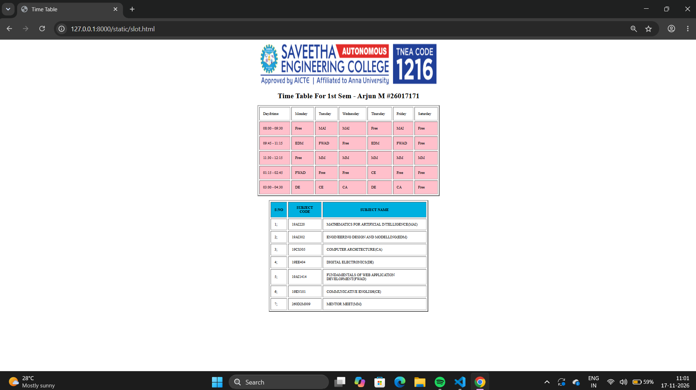

# Ex02 Time Table
## Date:17-11-2026

## AIM
To write a html webpage page to display your slot timetable.

## ALGORITHM
### STEP 1
Create a Django-admin Interface.

### STEP 2
Create an App inside the Django project.

### STEP 2
Create a static folder uder the created App and insert HTML code.

### STEP 3
Create a simple table using ```<table>``` tag in html with the relevant attributes.

### STEP 4
Add rows using ```<tr>``` tag.

### STEP 5
Add your course schedule using ```<td>``` tag.

### STEP 6
Execute the program using runserver command.

## PROGRAM
```
<html>
    <head>
        <title> Time Table </title>
    </head>
    <body>
        <center>
           
               <h1>Time Table For 1st Sem - Arjun M #26017171</h1>
        </center>
        <table border="4"
        cellspacing="5"
        cellpadding="15"
        align="center" width="800" height="400"
            <thead bgcolor="white">
                <tr>
                    <td>Day&time</th>
                    <td>Monday</th>
                    <td>Tuesday</th>
                    <td>Wednesday</th>
                    <td>Thursday</th>
                    <td>Friday</th>
                    <td>Saturday</th>
                </tr>
            </thead>
            <tbody bgcolor="pink">
                <tr>
                    <td>08:00 - 09:30</th>
                    <td>Free</th>
                    <td>MAI</th>
                    <td>MAI</th>
                    <td>Free</th>
                    <td>MAI</th>
                    <td>Free</th>
                </tr>
                <tr>
                    <td>09:45 - 11:15</td>
                    <td>EDM</td>
                    <td>FWAD</td>
                    <td>Free</td>
                    <td>EDM</td>
                    <td>FWAD</td>
                    <td>Free</td>
                </tr>
                <tr>
                    <td>11:30 - 12:15</td>
                    <td>Free</td>
                    <td>MM</td>
                    <td>MM</td>
                    <td>MM</td>
                    <td>MM</td>
                    <td>MM</td>
                </tr>
                <tr>
                    <td>01:15 - 02:45</td>
                    <td>FWAD</td>
                    <td>Free</td>
                    <td>Free</td>
                    <td>CE</td>
                    <td>Free</td>
                    <td>Free</td>
                </tr>
                <tr>
                    <td>03:00 - 04:30</td>
                    <td>DE</td>
                    <td>CE</td>
                    <td>CA</td>
                    <td>DE</td>
                    <td>CA</td>
                    <td>Free</td>
                </tr>                
            </tbody>
        </table>
        <br>
        <table border="4"
        cellspacing="5"
        cellpadding="15"
        align="center" width="700" height="300">
            <thead bgcolor="sky blue">
                <tr>
                    <th>S:NO</th>
                    <th>SUBJECT CODE</th>
                    <th>SUBJECT NAME</th>
                </tr>
            </thead>
            <tbody bgcolor="white">
                <tr>
                    <td>1;</td>
                    <td>19AI220</td>
                    <td>MATHEMATICS FOR ARTIFICIAL INTELLIGENCE(MAI)</td>
                </tr>
                <tr>
                    <td>2;</td>
                    <td>19AI302</td>
                    <td>ENGINEERING DESIGN AND MODELLING(EDM)</td>
                </tr>
                <tr>
                    <td>3;</td>
                    <td>19CS305</td>
                    <td>COMPUTER ARCHITECTURE(CA)</td>
                </tr>
                <tr>
                    <td>4;</td>
                    <td>19EE404</td>
                    <td>DIGITAL ELECTRONICS(DE)</td>
                </tr>
                <tr>
                    <td>5;</td>
                    <td>19AI1414</td>
                    <td>FUNDAMENTALS OF WEB APPLICATION DEVELOPMENT(FWAD)</td>
                </tr>
                <tr>
                    <td>6;</td>
                    <td>19EN101</td>
                    <td>COMMUNICATIVE ENGLISH(CE)</td>
                </tr>
                <tr>
                    <td>7;</td>
                    <td>260D2M009</td>
                    <td>MENTOR MEET(MM)</td>
                </tr>
            </tbody>
        </table>
    </body>
</html>

```

## OUTPUT
webpage


## RESULT
The program for creating slot timetable using basic HTML tags is executed successfully.
